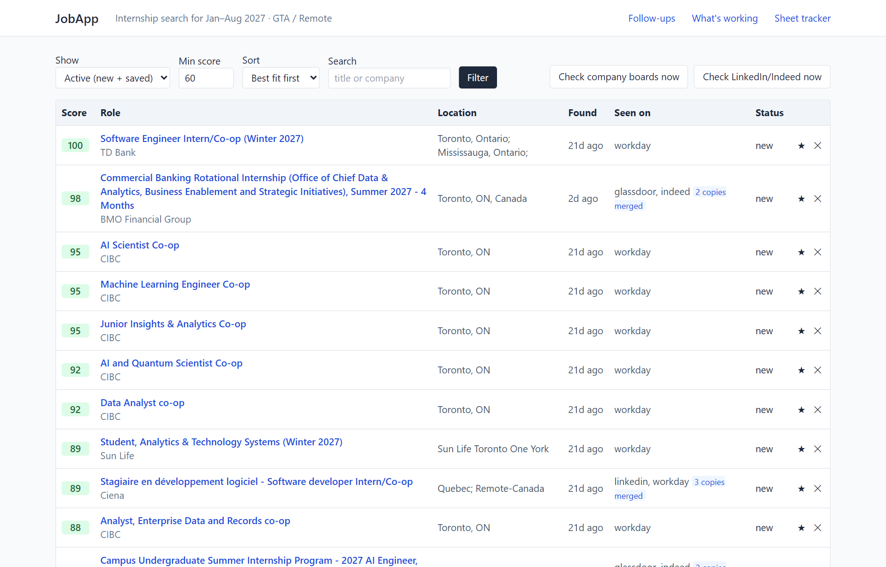
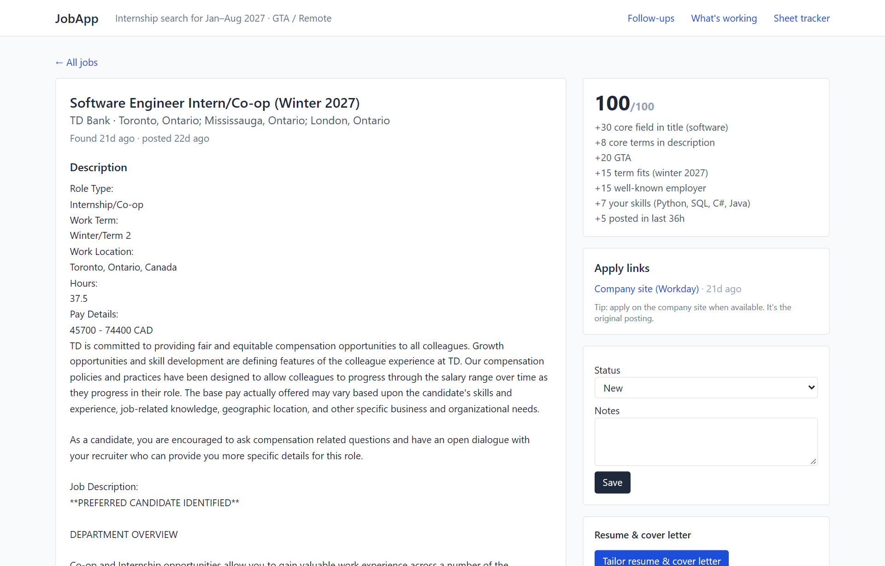
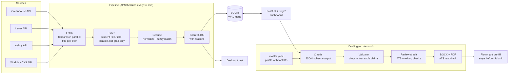

# JobApp

**A local, human-in-the-loop assistant for running a large internship search.** JobApp watches
84 company career boards, merges cross-posted duplicates, ranks every posting against my profile,
and sends a desktop alert within minutes of a good one going live. When I decide to apply, it drafts
a tailored resume and cover letter that can only use facts I've written down, checks the PDF the
way an applicant tracking system would read it, and pre-fills the application form. Then it stops,
so I can review everything and submit it myself.

Built with Python, FastAPI, SQLite, Playwright and the Claude API.



---

## Why I built it

Applying early matters for internships, and I was aiming for 200+ applications. Done by hand, that
means checking dozens of career sites every day, rewriting the same resume over and over, and typing
the same answers into hundreds of forms. I wanted to automate the repetitive parts while keeping
every decision, every claim about me, and every submission under my control.

## What it does

| Stage | What happens |
|---|---|
| **Find** | Polls public job-board APIs (Greenhouse, Lever, Ashby, Workday) every 10 minutes |
| **Filter & dedupe** | Keeps student roles in my fields and locations, drops Master's/PhD-only postings, and merges the same job found on several sites into one entry |
| **Rank & alert** | Scores each posting out of 100 with an explainable breakdown; Windows toast for anything above the threshold |
| **Tailor** | Claude selects and rephrases bullets from my profile and writes a cover letter. Code rejects anything it can't trace back to a real fact |
| **Review** | Side-by-side editor with an ATS keyword match, an "AI-tells" writing check, and `[NEEDS: …]` placeholders that block approval |
| **Export & verify** | Writes DOCX and PDF, then reads the PDF back as plain text to check that a parser sees what a recruiter would |
| **Pre-fill** | Opens the real application in Chrome, fills in known fields and attaches the files. **Never clicks Submit** |
| **Follow through** | Status history, interview-rate stats, follow-up reminders and referral-message drafts. Messages are drafted only, never sent |



---

## Architecture



### Request flow for a single posting

1. **Fetch.** Board fetchers run in a thread pool. Titles are filtered *before* fetching full
   descriptions, which cut a full sweep of 84 boards from over 10 minutes to about 50 seconds.
2. **Write.** Parsed postings are written in one short transaction under a write lock, so the
   dashboard never waits on network I/O for the database.
3. **Draft.** Tailoring runs in a background thread. The UI polls the draft's status, and the
   validated JSON is stored for review and editing.
4. **Approve.** Files are rendered, converted to PDF, checked by the ATS read-back, and the job moves
   to "docs ready".
5. **Apply.** Pre-fill starts a separate Playwright process with a persistent Chrome profile, so
   logins survive between sessions and the web server stays responsive.

---

## Technical highlights

### Deduplication across sources
The same internship often appears on a company's Workday site and on two or three aggregators,
each with a slightly different title and location. `dedupe.py` matches postings in three steps:
- **Normalizes company names** with an alias table (e.g. "TD Bank" and "TD Bank Group").
- **Compares titles** with `rapidfuzz.token_sort_ratio` after stripping noise words. A score of 92 or
  above means the same job; 80 to 91 counts only if the descriptions also match.
- **Groups locations into regions**, so "Toronto, ON" and "Mississauga, Ontario" both count as the
  GTA.

A merged job keeps every source link, so I can always apply on the original company site.

### Explainable scoring
`scoring.py` is deliberately rule-based rather than ML: with a few hundred postings and no labels,
transparent rules beat a model I couldn't validate. Every score comes with its reasons, for example
"+30 core field in title", "+20 GTA", "-30 term doesn't fit Jan–Aug 2027" or "+7 your skills
(Python, SQL…)". The weights live in `config.yaml`.

### Keeping the LLM truthful
The biggest risk in AI-tailored resumes is invented experience, so truthfulness is enforced in
code, not just in the prompt:
- `profile.py` gives every fact a stable ID (`exp0.b2`, `proj3.b0`).
- The model must return JSON that matches a schema, and **every bullet must cite the fact IDs it came
  from**.
- `tailor.validate()` drops any bullet whose sources are missing or belong to a different entry,
  any skill not in the profile, and any invented entry. It also restores experience the model left
  out.
- Anything the model would need to guess becomes a `[NEEDS: …]` placeholder, and the UI won't
  approve a draft while one remains.
- Profile entries can be marked `confirm: true` (draft wording) or `hide: true` (never used).

### Two LLM backends
`tailor.call_model()` runs either through the Claude Code CLI (`claude -p` with a JSON schema)
or through the Anthropic Python SDK with structured outputs, chosen in `config.yaml`. Running the
CLI in a minimal mode (no tools, no MCP servers, no session persistence) cut each call from about
111K to 16K input tokens.

### ATS read-back
`ats_check.py` uses `pypdf` to extract the exported resume's text, as a parser would, and checks:
- the text is selectable and the resume fits on one page
- name, email, phone, LinkedIn and GitHub are readable
- the section headings appear in the expected order
- there are no garbled characters
- what share of the posting's keywords survived into the PDF

### Safe form pre-fill
`prefill.py` collects every input, including those inside iframes and shadow DOM, then classifies
each field from its label, name and placeholder text and fills it from the profile. Hard rules,
enforced in code and covered by tests:
- Never clicks Submit, never types passwords, never touches CAPTCHAs.
- Never ticks consent checkboxes.
- Only fills **empty** fields, so it never overwrites anything typed by hand.
- Leaves U.S.-specific questions and free-text essays for a person, listing them in a "Needs you"
  panel injected into the page.

### Measuring what works
Every status change is logged to `status_history`, so `stats.py` can report interview rates by role
type, employer, source, tailored vs. not, fit score and follow-up. A rejection after an interview
still counts as an interview.

---

## Tech stack

| Layer | Tools |
|---|---|
| Backend | Python 3.14, FastAPI, Jinja2, APScheduler |
| Data | SQLite (WAL), small in-code migration system |
| Matching | rapidfuzz, custom text normalization |
| AI | Claude (Anthropic SDK or Claude Code CLI), JSON-schema structured output |
| Documents | python-docx, docx2pdf (Word), pypdf |
| Browser automation | Playwright (Chrome, persistent context) |
| Frontend | Server-rendered HTML, Tailwind CSS (CDN), no build step |
| Notifications | winotify (Windows toasts) |
| Testing | pytest, including headless-Chrome tests against mock application forms |

## Project layout

```
app/
  main.py          FastAPI routes + scheduler
  pipeline.py      fetch -> filter -> dedupe -> score -> store
  sources/         job-board API clients
  text.py          normalization, location and term matching
  dedupe.py        cross-source duplicate detection
  scoring.py       filters and explainable fit score
  profile.py       loads the profile and assigns fact IDs
  tailor.py        LLM calls, schema, validation, ATS keyword scoring
  humanize.py      writing-style rules and local "AI tells" checker
  documents.py     DOCX/PDF rendering
  ats_check.py     PDF read-back checks
  prefill.py       Playwright form filler
  stats.py, followups.py, outreach.py, tracker.py
  templates/       dashboard pages
profile/
  master.example.yaml   fictional example profile (copy to master.yaml)
tests/                  37 tests, run against the example profile
```

## Running it locally

Requires Windows, Python 3.12+ and Google Chrome. Microsoft Word is optional and only needed for
PDF export.

```powershell
git clone https://github.com/MichaelLauSheridan/jobapp.git
cd jobapp
python -m venv .venv
.venv\Scripts\pip install -r requirements.txt
.venv\Scripts\python -m playwright install chromium
copy profile\master.example.yaml profile\master.yaml   # then edit with your own facts
run.bat                                                 # opens http://localhost:8000
```

For AI drafting, either sign in to the Claude Code CLI, or set `tailor.backend: api` in
`config.yaml` and put `ANTHROPIC_API_KEY=...` in a `.env` file.

### Tests

```powershell
.venv\Scripts\python -m pytest -q
```

## Design principles

- **A person stays in charge.** JobApp drafts, fills and reminds. It never submits an application or sends
  a message.
- **No invented facts.** Every resume line traces back to the profile. Gaps become `[NEEDS: …]`.
- **Personal data stays local.** The real profile, database, generated documents and API keys are
  git-ignored. The repo ships with a fictional example profile.
- **Polite to job sites.** It uses public job-board APIs where they exist, polls at modest intervals, and
  sends a normal User-Agent.

---

Built by **Michael Lau**, Honours Computer Science (Data Analytics) student at Sheridan College.
[LinkedIn](https://www.linkedin.com/in/michael-lau-a29aa2352/) · [GitHub](https://github.com/MichaelLauSheridan)
